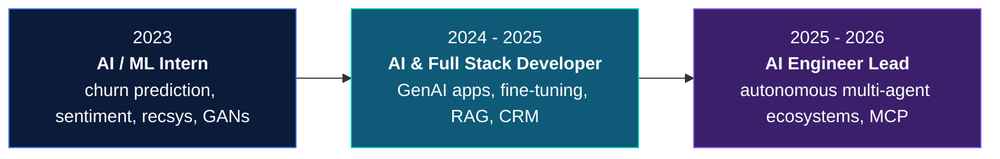
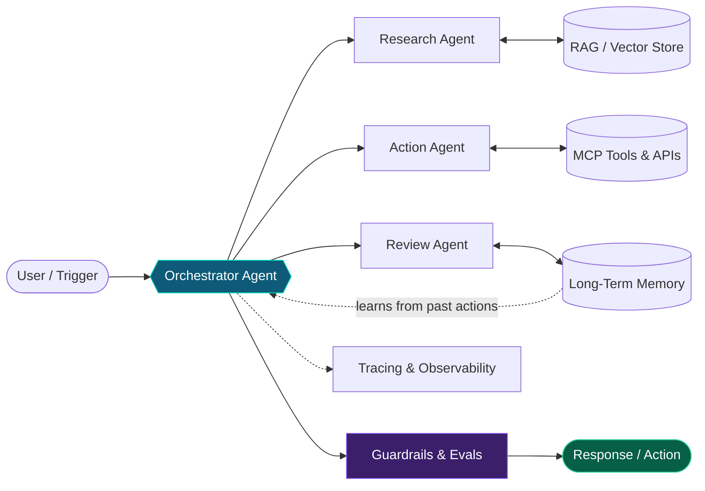
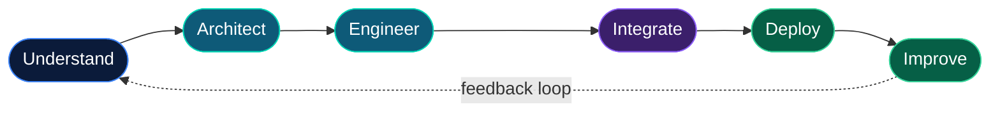

<div align="center">


<a href="https://umerriaz.netlify.app">
  
</a>

<br/><br/>

<a href="https://umerriaz.netlify.app"></a>
<a href="https://www.linkedin.com/in/umer-riaz-b08427223"></a>
<a href="mailto:umerriaz5646@gmail.com"></a>


<br/><br/>


</div>

<br/>


## Profile

I turn complex ideas into intelligent, production-ready products. My work spans system architecture, agent orchestration, backend services, interfaces, infrastructure, and deployment, with a focus on AI systems that are reliable, observable, and built for real use.

```bash
umer@agentic-lab:~$ whoami
> AI Engineer Lead · software engineer · builder of agentic products

umer@agentic-lab:~$ cat stack.json
{
  "agents":    ["LangGraph", "LangChain", "LangMem", "OpenAI Agent SDK", "Google ADK", "MCP"],
  "retrieval": ["FAISS", "Weaviate", "LanceDB", "Pinecone", "Chroma"],
  "backend":   ["FastAPI", "NestJS", "WebSockets", "SSE", "PostgreSQL", "Redis"],
  "ship":      ["Docker", "AWS", "Terraform", "GitHub Actions", "Triton"],
  "degree":    "BS in Artificial Intelligence",
  "mantra":    "A solution isn't finished when it runs locally."
}

umer@agentic-lab:~$ ./focus --now
> multi-agent collaboration · memory-augmented reasoning · MCP tooling
```

<table>
<tr>
<td width="25%" valign="top">

**Agentic Systems**
<br/><sub>Autonomous agents, multi-agent ecosystems, tool orchestration, MCP, long-term memory.</sub>

</td>
<td width="25%" valign="top">

**Software Engineering**
<br/><sub>APIs, backend services, real-time communication, databases, scalable architecture.</sub>

</td>
<td width="25%" valign="top">

**End-to-End Products**
<br/><sub>Requirements, implementation, integration, testing, deployment, iteration.</sub>

</td>
<td width="25%" valign="top">

**DevOps & Infrastructure**
<br/><sub>Containers, CI/CD, cloud deployment, automation, observability.</sub>

</td>
</tr>
</table>


## Career Trajectory



<details>
<summary><b>Leadership highlights</b></summary>

<br/>

- Led development of AI agents with **multi-context perception**, vector databases, and **dynamic tool orchestration** for autonomous workflows
- Architected **human-like autonomous agents** that build connection networks, manage profiles, and interact socially inside multi-agent ecosystems with emergent behaviors
- Integrated tools through **MCP** to give agents contextual reasoning and extended capabilities
- Built agents that **self-improve** by learning from past interactions, decisions, and actions
- Implemented **trace-based observability** and debugging pipelines for complex agent behavior
- Delivered production-ready AI with **remote, distributed teams**, tying cutting-edge research to practical business use

</details>


## Architecture

The pattern my agent systems are built around:




## Tech Arsenal

<div align="center">


<br/><br/>


</div>

<details>
<summary><b>Full breakdown by domain</b></summary>

<br/>

| Domain | Technologies & Focus |
|:--|:--|
| **Agentic AI** | LangChain · LangGraph · LangMem · OpenAI Agent SDK · Google ADK · Azure AI Foundry · MCP · tool calling · multi-agent systems |
| **LLMs & GenAI** | GPT-4o · Claude 3 · LLaMA 3 · Mistral 7B · Mixtral · QLoRA · PEFT · Unsloth · Flash Attention 2 · chain-of-thought · structured outputs |
| **Retrieval & Memory** | RAG · embeddings · semantic search · FAISS · Weaviate · LanceDB · Pinecone · Chroma · long-term agent memory |
| **ML & Vision** | PyTorch · TensorFlow · Keras · scikit-learn · XGBoost · NLP · OpenCV · YOLOv11 · CLIP · BLIP-2 · diffusion models · GANs |
| **Backend** | FastAPI · Flask · NestJS · Express.js · REST · WebSockets · Server-Sent Events · rate limiting · Triton inference servers |
| **Frontend & Data** | React · Next.js · PostgreSQL · MongoDB · Redis · SQL · EDA & visualization |
| **Scraping** | Crawl4AI · Playwright · ScrapeGraphAI · SearXNG |
| **DevOps & Cloud** | Docker · AWS · Git · CI/CD · GitHub Actions · Terraform · deployment automation |

</details>


## Selected Builds

<table>
<tr>
<td width="50%" valign="top">

#### Autonomous Social Agents
Human-like agents that build connection networks, manage profiles, and post, comment, and engage with peers inside multi-agent ecosystems, improving themselves from past interactions.

`LangGraph` `LangMem` `OpenAI Agent SDK` `MCP` `Vector Stores`

</td>
<td width="50%" valign="top">

#### Integri: AI Immigration & Integration Assistant
A multilingual mobile app for expats, refugees, and immigrants: live updates on laws and aid programs, legal and daily-life guidance, email drafting, document explanations, and learning modules.

 

`LLMs` `NLP` `Multilingual UX` `Mobile`

</td>
</tr>
<tr>
<td width="50%" valign="top">

#### StubCollect: AI Stub Recognition & Marketplace
An autonomous agent that reads uploaded stubs, extracts event context, and prepares listings. Includes web-search fallback, validation, real-time buyer–seller chat, Stripe payments and payouts, and fraud detection.

[stubcollect.com](https://www.stubcollect.com)

`AI Agents` `FastAPI` `WebSockets` `SSE` `Stripe`

</td>
<td width="50%" valign="top">

#### Conversational Intelligence
A Whisper + LLM pipeline that transcribes call recordings and extracts sentiment, intent, issues, and timestamped outcomes, then scores agent performance on empathy, resolution, clarity, and compliance.

`Whisper` `LLMs` `NLP` `FastAPI` `Dashboard`

</td>
</tr>
<tr>
<td width="50%" valign="top">

#### Drone Detection (Computer Vision)
YOLOv11m detector for dynamic, moving-camera footage with motion blur, lighting shifts, and defocus, backed by a custom augmentation pipeline.

  

`YOLOv11` `Albumentations` `PyTorch` `OpenCV`

</td>
<td width="50%" valign="top">

#### AI Search & Extraction Bot
A chatbot with conversation memory that aggregates results through metasearch and extracts structured data using browser automation, built as a real-time retrieval pipeline.

`SearXNG` `Crawl4AI` `Playwright` `ScrapeGraphAI`

</td>
</tr>
<tr>
<td width="50%" valign="top">

#### GenAI Apps & LLM Fine-Tuning
Real-time multimodal GenAI apps and domain-grounded RAG agents, with efficient fine-tuning and low-latency serving.

`GPT-4o` `LLaMA 3` `Mistral` `QLoRA` `Unsloth` `Triton` `FAISS` `LanceDB`

</td>
<td width="50%" valign="top">

#### Medical Image VQA & Report Generation
Final-year research on multimodal Visual Question Answering and automated report generation for medical images, bridging vision and language for diagnostics and documentation.

`Multimodal` `Computer Vision` `NLP`

</td>
</tr>
</table>


## Certifications

<div align="center">


</div>


## GitHub Signals

<div align="center">


</div>

## How I Build



<br/>

| | Principle |
|:-:|:--|
| 01 | **Systems over demos.** Maintainability, observability, security, and reliability from day one. |
| 02 | **AI with purpose.** Agents and LLMs where they solve a genuine problem, not where they're just trendy. |
| 03 | **Full lifecycle ownership.** Models, APIs, data, interfaces, and infrastructure working as one product. |
| 04 | **Production matters.** Deployment and iteration are part of the job, not an afterthought. |

<br/>

<div align="center">

### Have a challenging idea? Let's turn it into something real.

<a href="https://umerriaz.netlify.app"></a>
<a href="https://www.linkedin.com/in/umer-riaz-b08427223"></a>
<a href="mailto:umerriaz5646@gmail.com"></a>

<br/><br/>

<sub>AI ENGINEERING · SOFTWARE ENGINEERING · PRODUCT DELIVERY · DEVOPS</sub>


</div>
